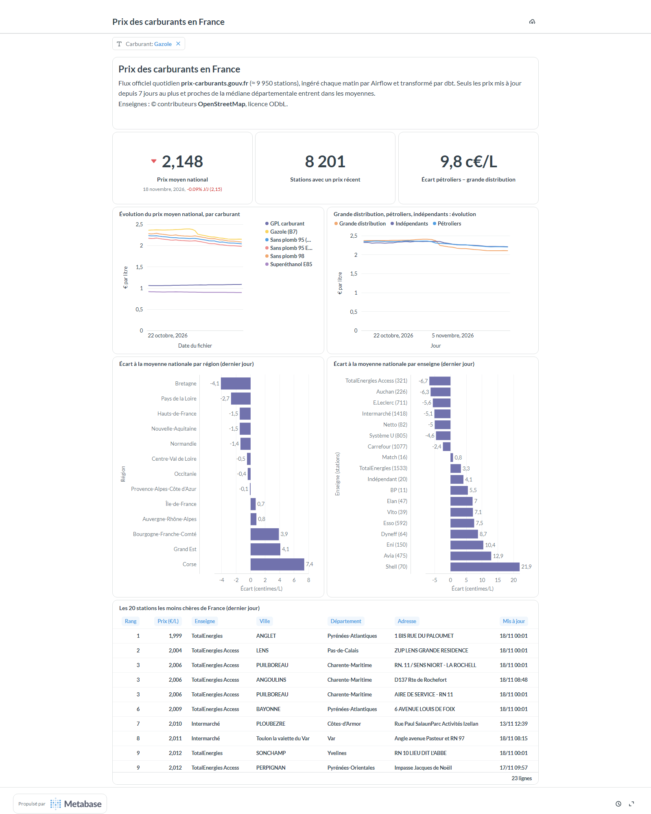
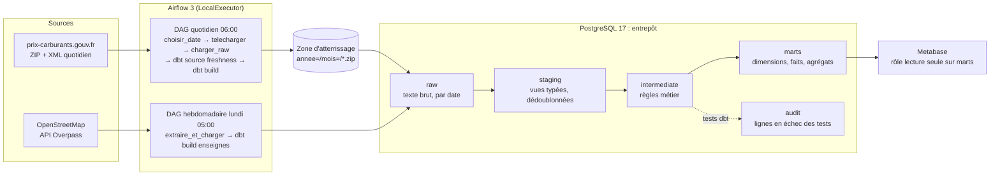
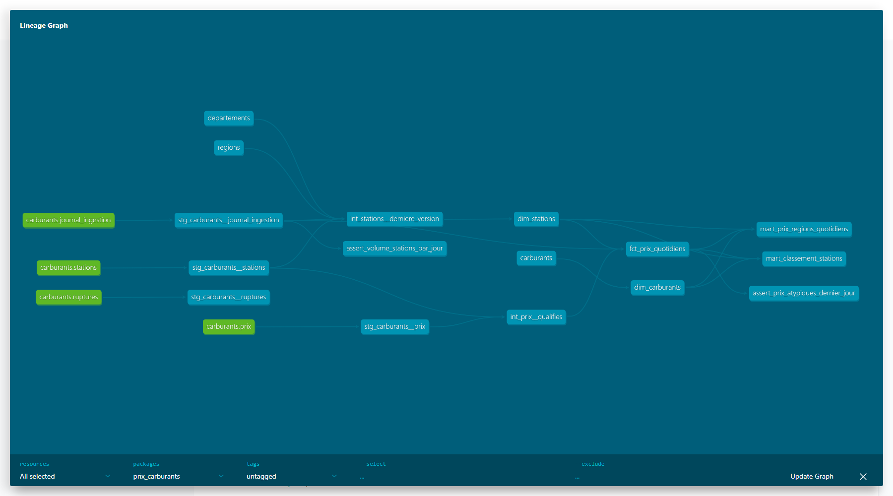

# Prix des carburants en France : une stack data batch avec Airflow, dbt et Metabase

Chaque matin, ce projet ingère le flux officiel des prix des carburants (≈ 9 950 stations),
le charge dans un entrepôt PostgreSQL, le transforme et le **teste** avec dbt, puis alimente
un tableau de bord Metabase : évolution des prix, comparaison par région et par enseigne,
stations les moins chères.

Il complète mon projet [real-time-analytics-pipeline](https://github.com/Daoudbamba/real-time-analytics-pipeline)
(Kafka, Spark, temps réel) par l'autre moitié du métier : le **batch** et l'**analytics engineering**.



## Sommaire

- [Problématique](#problématique)
- [Résultats en chiffres](#résultats-en-chiffres)
- [Architecture](#architecture)
- [Ingestion et orchestration](#ingestion-et-orchestration)
- [Modèles dbt](#modèles-dbt)
- [Qualité des données](#qualité-des-données)
- [Tableau de bord](#tableau-de-bord)
- [Intégration continue](#intégration-continue)
- [Choix techniques](#choix-techniques)
- [Limites](#limites)
- [Installation](#installation)
- [Structure du dépôt](#structure-du-dépôt)
- [Sources et licences](#sources-et-licences)

## Problématique

Le flux open data [prix-carburants.gouv.fr](https://www.prix-carburants.gouv.fr/rubrique/opendata/)
est riche mais brut :

- un **fichier XML par jour**, qui n'est qu'un instantané du dernier prix connu de chaque
  station : un même prix se répète d'un jour à l'autre, certains n'ont pas bougé depuis 2009 ;
- la source ne garde qu'**environ un mois** de fichiers, et répond `HTTP 200` avec une page HTML
  pour une date absente au lieu d'un 404 ;
- ni **département**, ni **région**, ni **enseigne** : il faut les reconstruire ;
- des **anomalies réelles** : doublons, station de test (code postal 99999), prix atypiques.

Objectif : une chaîne quotidienne **fiable, rejouable et testée**, où une donnée fausse ne peut
pas atteindre le tableau de bord sans être arrêtée.

## Résultats en chiffres

Mesures réelles sur la stack locale (Windows 11, 16 Go de RAM, Docker Desktop), novembre 2026.

| Mesure | Valeur |
|---|---|
| Jours ingérés | **35** (du 15/10 au 18/11/2026), sans trou ni doublon |
| Volume brut | 348 221 lignes stations-jours, 1 079 132 prix, 944 080 ruptures ; 38 Mo de ZIP, 321 Mo dans `raw` |
| Table de faits | 1 078 954 prix (station × carburant × jour) |
| Ingestion d'un jour | 2,8 s (téléchargement, analyse du XML, chargement), pic mémoire 82 Mo |
| Rattrapage de 33 jours | 214 s, une exécution à la fois |
| DAG quotidien complet | ≈ 53 s, dont 44 s de `dbt build` |
| `dbt build` | 14 modèles, 4 seeds, 76 tests : **91 réussis, 3 avertissements, 0 erreur**, ≈ 40 s |
| Tests Python | 44 tests Pytest (unitaires et intégration PostgreSQL), plus 3 tests de DAG dans l'image Airflow |
| Mémoire de la stack | ≈ 2,1 Go au repos, Metabase 1,30 Go sous charge (VM Docker de 7,7 Go) |

Ce que disent les données, pour le **gazole** (prix mis à jour depuis 7 jours au plus) :

| Constat | Valeur |
|---|---|
| Prix moyen national, 15/10 → 18/11/2026 | 2,359 € → **2,148 €** (−21,1 c€) |
| Grande distribution vs pétroliers, 18/11 | 2,104 € vs 2,202 € : **9,8 c€/L d'écart** |
| Enseigne la moins chère / la plus chère | TotalEnergies Access −6,7 c€ / Shell +21,9 c€ (écart à la moyenne nationale) |
| Région la moins chère / la plus chère | Bretagne −4,1 c€ / Corse +7,4 c€ |
| Station la moins chère, 18/11 | 1,999 € (Anglet, Pyrénées-Atlantiques) |

## Architecture



Tout tourne dans Docker Compose : PostgreSQL (trois bases : `airflow`, `entrepot`, `metabase`),
Airflow (serveur d'API, ordonnanceur, processeur de DAG), Metabase. Chaque service a une limite
mémoire, et `scripts/demarrer.sh` refuse de lancer la stack si la VM Docker manque de mémoire.

## Ingestion et orchestration

Le code d'ingestion (`src/fuel_prices/`) est du Python testé, indépendant d'Airflow :

| Module | Rôle |
|---|---|
| `telechargement.py` | ZIP du jour vers la zone d'atterrissage ; vérifie la **signature ZIP** (la source renvoie du HTML avec un code 200 pour une date absente), écriture atomique, fichier réutilisé s'il est déjà là |
| `analyse.py` | lecture du XML en flux (`iterparse`), valeurs gardées **en texte** dans `raw` : les conversions et les contrôles sont le travail de dbt |
| `chargement.py` | `DELETE` + `COPY` de la date dans **une seule transaction**, verrou consultatif par date, journal d'ingestion |
| `osm.py` | enseignes depuis OpenStreetMap (tag `ref:FR:prix-carburants`), réessais sur les erreurs 502 d'Overpass |

**Idempotence.** Rejouer une date remplace exactement ses données : c'est ce qui permet de corriger
une erreur en relançant simplement le DAG. Rejouer un jour :
`airflow dags trigger prix_carburants_quotidien -c '{"date_fichier": "2026-11-02"}'` ;
une période : `airflow backfill create --dag-id prix_carburants_quotidien --from-date … --to-date …`.

**Échecs utiles.** Une date sortie de la fenêtre de rétention échoue dès le premier essai (inutile de
réessayer) ; un fichier publié en retard est réessayé 3 fois à 30 minutes d'intervalle ; un test dbt
en erreur fait échouer le DAG sans réessai : réessayer ne corrige pas une donnée fausse.

## Modèles dbt



| Couche | Modèles | Matérialisation | Rôle |
|---|---|---|---|
| **staging** | `stg_carburants__stations`, `__prix`, `__ruptures`, `__journal_ingestion`, `stg_osm__enseignes` | vues | types, unités (coordonnées ÷ 100 000), fuseau Europe/Paris, **dédoublonnage**, département déduit du code postal (Corse 2A/2B, outre-mer) |
| **intermediate** | `int_prix__qualifies`, `int_stations__derniere_version`, `int_stations__enseignes` | vues | ancienneté du prix, prix « récent », écart à la médiane départementale, enseigne normalisée |
| **marts** | `dim_stations`, `dim_carburants`, `fct_prix_quotidiens` | tables, faits **incrémentaux** | modèle en étoile exposé à Metabase |
| **marts** | `mart_prix_regions_quotidiens`, `mart_prix_enseignes_quotidiens`, `mart_classement_stations` | tables | agrégats prêts pour le tableau de bord |

Référentiels versionnés en **seeds** : départements et régions ([geo.api.gouv.fr](https://geo.api.gouv.fr)),
carburants avec leurs bornes de prix plausibles, correspondance des 51 libellés de marque OSM vers
21 enseignes (`Total`, `Total Energies`, `TotalEnergies` → TotalEnergies ; Total Access gardé à part).

`fct_prix_quotidiens` est **incrémentale** (`delete+insert` par date) : seules les dates chargées
ou rechargées depuis la dernière construction sont recalculées (32 553 lignes pour un jour).

## Qualité des données

**76 tests dbt**, de trois natures :

- **génériques** : `not_null`, `unique`, `relationships` (prix → stations, stations → départements →
  régions), `accepted_values` (carburants, types de route, types d'enseigne), unicité de combinaisons
  et plages de valeurs (`dbt_utils`) ;
- **métier**, bloquants : `prix_dans_les_bornes` (test générique maison : chaque prix récent dans les
  bornes plausibles de son carburant), volume minimal de stations par jour, aucun prix mis à jour
  après la publication du fichier ;
- **surveillance**, en avertissement : prix atypiques du dernier jour, couverture des enseignes,
  marques OSM absentes du référentiel ; plus la **fraîcheur** des sources (`dbt source freshness`).

Les tests ont trouvé de vraies anomalies dans le flux officiel, signalées sans bloquer :

| Anomalie réelle | Traitement |
|---|---|
| 38 doublons exacts (même station, carburant et date) | dédoublonnés en staging, unicité testée |
| Station de test « 99999001 », code postal 99999, présente chaque jour | avertissement, écartée des marts |
| 213 721 prix anciens (le plus vieux date d'avril 2009) | gardés et signalés, exclus des moyennes |
| 275 prix récents à plus de 40 % de la médiane de leur département | signalés (`est_atypique`), exclus des moyennes |

### Démonstration : une donnée cassée est arrêtée

`scripts/demo_donnee_cassee.sh` multiplie par 10 un vrai prix de gazole (la virgule décalée), lance
dbt, puis corrige en rejouant l'ingestion. Sortie réelle (extrait de
[docs/demo_donnee_cassee.txt](docs/demo_donnee_cassee.txt)) :

```text
===== 1. Donnée cassée : un prix de gazole multiplié par 10 dans raw.prix =====
 2026-11-18   | 1000001    | Gazole    | 20.690

===== 2. dbt build : le test métier doit échouer et bloquer les marts =====
58 of 94 FAIL 1 prix_dans_les_bornes_int_prix__qualifies_prix_litre__ref_carburants_
Done. PASS=78 WARN=3 ERROR=1 SKIP=12 NO-OP=0 REUSED=0 TOTAL=94

===== Lignes fautives conservées par dbt dans le schéma audit =====
 2026-11-18   |    1000001 | Gazole         |     20.690 |              1.000 |              3.500

===== 3. Correction : rejeu idempotent de l'ingestion du 2026-11-18 =====
 2026-11-18   | 1000001    | Gazole    | 2.069

===== 4. dbt build après correction =====
Done. PASS=91 WARN=3 ERROR=0 SKIP=0 NO-OP=0 REUSED=0 TOTAL=94
```

Le test échoue, les **12 nœuds en aval** (tous les marts) ne sont pas reconstruits : le tableau de
bord garde les derniers chiffres valides. La ligne fautive reste consultable dans
`audit.echecs_prix_hors_bornes`. La CI rejoue ce scénario à chaque push.

## Tableau de bord

Le tableau de bord est **du code** : `scripts/metabase_tableau_de_bord.py` le crée par l'API de
Metabase (compte administrateur, connexion à l'entrepôt avec un rôle en lecture seule limité au
schéma `marts`, 8 questions SQL, filtre « Carburant »). Relancer le script le recrée à l'identique.

Choix de lecture : les comparaisons régionales et par enseigne sont en **écart à la moyenne nationale
(centimes/L)**. Sur un axe partant de zéro, 2,08 € et 2,20 € paraîtraient identiques ; un écart se lit
directement, sans tronquer l'axe.

## Intégration continue

GitHub Actions ([.github/workflows/ci.yml](.github/workflows/ci.yml)), trois jobs en parallèle :

| Job | Contenu |
|---|---|
| `python` | Ruff (lint et format), Pytest avec un PostgreSQL 17 de service |
| `dbt` | charge **deux vrais fichiers quotidiens réduits à 250 stations** (`tests/donnees/`) avec le code d'ingestion de production, `dbt parse`, `dbt build`, vérifie qu'une donnée cassée est bien détectée, publie la documentation dbt |
| `airflow` | construit l'image, vérifie que les DAG s'importent et gardent leur structure, valide la configuration Docker Compose |

## Choix techniques

**Pourquoi dbt plutôt que des scripts SQL.** Le même SQL, mais avec ce que des scripts n'ont pas :
l'ordre d'exécution déduit des `ref()` (le graphe ci-dessus), des tests qui **bloquent** la suite au lieu
de laisser passer une donnée fausse, la documentation générée, l'incrémental, et des référentiels
versionnés. C'est l'angle du post LinkedIn associé : [docs/post-linkedin.md](docs/post-linkedin.md).

**Pourquoi `raw` en texte.** Une valeur aberrante doit arriver jusqu'aux tests dbt, visible et
traçable, plutôt qu'être corrigée en silence par le code Python.

**Pourquoi OpenStreetMap pour les enseignes.** Le flux officiel ne donne pas l'enseigne, OSM la
donne et la relie à l'identifiant officiel : 92,8 % des stations du dernier fichier ont une
enseigne connue. Extraction hebdomadaire : les enseignes changent peu et Overpass est un service
communautaire.

**Pourquoi la mémoire compte.** La VM Docker n'a que 7,7 Go et d'autres projets peuvent tourner à
côté : limites par conteneur mesurées, une seule exécution de DAG à la fois, garde-fou au démarrage.

## Limites

- **Un mois d'historique** au démarrage : la source ne garde qu'environ un mois. L'historique s'allonge
  chaque jour (les ZIP sont conservés) ; aller plus loin demanderait d'ingérer les fichiers annuels.
- **Instantané, pas d'historique des changements** : le fichier quotidien donne le dernier prix connu ;
  les changements de prix intra-journaliers ne sont pas captés.
- **Enseignes OSM** : 7,2 % des stations restent sans enseigne, et 20 stations ont des marques
  différentes selon l'objet OSM (règle déterministe, cas signalés).
- **Bornes et seuils choisis** : bornes de prix plausibles, seuil d'écart de 40 % à la médiane,
  fenêtre de 7 jours pour un prix « récent ». Ce sont des règles explicites et paramétrables,
  pas des vérités statistiques.
- **Prix ronds** : 397 lignes de prix valent exactement 1 € ou 2 € sur les 35 jours ; elles sont
  plausibles et gardées, mais pourraient être des valeurs par défaut saisies par les stations.
- **Ruptures de stock** : nettoyées en staging mais pas encore exploitées dans un mart.
- **Performance** : la vue intermédiaire recalcule les médianes sur tous les jours ; la table
  incrémentale reste à ≈ 14 s, acceptable à cette échelle, à optimiser au-delà.
- **Local uniquement** : identifiants générés localement, lien public Metabase limité à 127.0.0.1.
  Un projet de déploiement sur AWS reprendra ces données.

## Installation

Prérequis : Docker Desktop (au moins 3 Go disponibles dans la VM), Git Bash, Python 3.12.

```bash
bash scripts/generer_env.sh
```

```bash
bash scripts/demarrer.sh
```

Le script vérifie la mémoire, construit l'image Airflow et attend que les cinq services soient sains
(141 s mesurées avec l'image déjà construite ; compter quelques minutes de plus pour la construire).
Ensuite :

```bash
.venv/Scripts/python scripts/metabase_tableau_de_bord.py
```

| Service | Adresse |
|---|---|
| Airflow | http://localhost:8082 |
| Metabase | http://localhost:3002 (identifiants dans `.env`) |
| PostgreSQL | `localhost:5433` |

Activer le DAG `prix_carburants_quotidien` dans Airflow ingère la veille ; pour l'historique
disponible (environ un mois), un rattrapage :

```bash
docker exec fuel-airflow-scheduler airflow backfill create --dag-id prix_carburants_quotidien --from-date 2026-10-16 --to-date 2026-11-18 --max-active-runs 1
```

Puis déclencher une fois `enseignes_osm_hebdomadaire` pour les enseignes.

**Tests en local** (environnement virtuel Python 3.12) :

```bash
py -3.12 -m venv .venv && .venv/Scripts/python -m pip install -r requirements/dev.txt
```

Sous Windows, si l'installation de dbt échoue sur un certificat SSL (dbt-core 1.12 télécharge un
composant depuis GitHub pendant l'installation), relancer avec
`SSL_CERT_FILE` pointant vers `pip/_vendor/certifi/cacert.pem` du venv.

```bash
.venv/Scripts/python -m pytest
```

Arrêt (les données sont conservées) : `bash scripts/arreter.sh`.

## Structure du dépôt

```text
airflow/dags/            DAG quotidien (prix) et hebdomadaire (enseignes)
src/fuel_prices/         ingestion : téléchargement, analyse XML, chargement, OSM
dbt/                     projet dbt : models/{staging,intermediate,marts}, seeds, tests, macros
tests/                   Pytest ; tests/donnees : extrait réel de 250 stations pour la CI
scripts/                 démarrage, garde-fou mémoire, démo donnée cassée, tableau de bord Metabase
docker/                  image Airflow (avec dbt), initialisation de PostgreSQL
docs/                    captures, sortie de la démo, brouillon du post LinkedIn
```

Stack : Python 3.12, Airflow 3.3.2, dbt-core 1.12.6 et dbt-postgres 1.11.0, dbt_utils 1.4.1,
PostgreSQL 17, Metabase 0.64.8, Docker Compose. Versions épinglées.

## Sources et licences

- Prix : [prix-carburants.gouv.fr](https://www.prix-carburants.gouv.fr/rubrique/opendata/), Licence
  Ouverte / Etalab. L'extrait de `tests/donnees/` en est issu.
- Enseignes : © contributeurs [OpenStreetMap](https://www.openstreetmap.org/copyright), licence ODbL.
  Les enseignes de la CI sont synthétiques ; aucun extrait OSM n'est versionné.
- Départements et régions : [geo.api.gouv.fr](https://geo.api.gouv.fr).

Projet réalisé par Daouda Bamba, dans le cadre d'une recherche d'alternance en Data Engineering.
